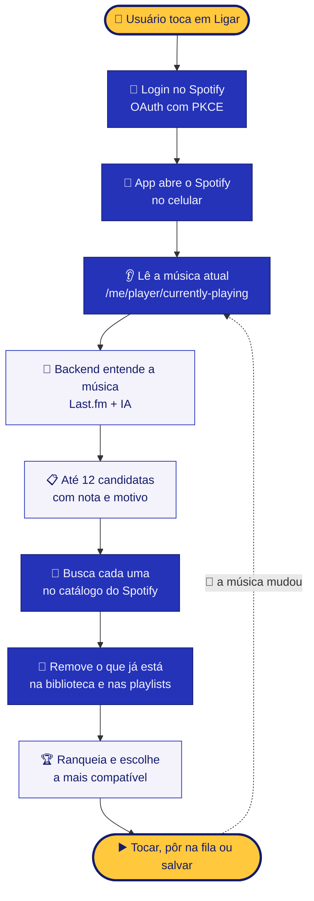

<p align="center">
  
</p>

<p align="center">
  
  
  
  
  
</p>

<p align="center">
  <b>Sintonia</b> é um app de celular que escuta o que está tocando no seu Spotify,<br>
  entende a música por dentro e encontra a próxima que você ainda não conhece. 🎧
</p>

---

## ✨ O que o Sintonia faz

| | Etapa | O que acontece |
|:-:|---|---|
| 🔌 | **Ligar** | Você toca no disco amarelo, entra com sua conta Spotify e o app abre o Spotify para você. |
| 👂 | **Ler** | O app identifica a música que está tocando agora. |
| 🧠 | **Entender** | Gênero, época, estilo, melodia e o perfil de quem costuma ouvir aquela música. |
| 🚫 | **Filtrar** | Tudo o que já está na sua biblioteca ou nas suas playlists fica de fora. |
| 🎯 | **Sugerir** | O app busca no Spotify e entrega a música mais compatível, pronta para tocar. |

---

## 🎧 Integração com o Spotify

<p align="center">
  <a href="https://open.spotify.com">
    
  </a>
</p>

O Sintonia se conecta à sua conta pela **Spotify Web API** para:

- 👂 ler a música que está tocando agora;
- 🔎 encontrar no catálogo as músicas sugeridas;
- 📚 conferir o que já está na sua biblioteca e nas suas playlists;
- ▶️ abrir a sugestão direto no app do Spotify, colocar na fila ou salvar.

Capas, nomes de músicas e de artistas exibidos no app são fornecidos pelo Spotify, sempre com link de volta para o Spotify.

> ℹ️ O Sintonia é um projeto independente, sem afiliação com o Spotify. O logo aparece apenas para indicar a origem do conteúdo, conforme as [diretrizes de marca do Spotify](https://developer.spotify.com/documentation/design).

---

## 🎬 Como funciona



---

## 🧠 Como a música é entendida

O backend combina duas fontes para montar o perfil da faixa:

| Fonte | O que traz |
|---|---|
| 🎙️ **Last.fm** | Tags da faixa e do artista (gênero, década, clima) e faixas semelhantes segundo ouvintes reais. É o sinal de **perfil dos ouvintes**. |
| 🤖 **IA** | Perfil completo: gêneros, época, estilo e **melodia** (andamento, tonalidade provável, contorno, instrumentação e clima), além das candidatas com nota de 0 a 100. |

> 💡 Do celular saem apenas **título, artista e ano**. Com `USAR_IA=false`, o app funciona só com dados públicos do Last.fm, sem enviar nada a um modelo de IA.

## 🏆 Como a sugestão é escolhida

| Critério | Peso |
|---|:-:|
| 🤖 Nota de compatibilidade da IA | **40%** |
| 🎙️ Similaridade entre ouvintes no Last.fm | **20%** |
| 📅 Proximidade de época | **20%** |
| 🎸 Gêneros em comum no Spotify | **20%** |
| 🧭 Mesmo artista da música original | **−10%** |

A penalidade para o mesmo artista é proposital: o objetivo é **descobrir**, não repetir. E se a IA sugerir uma música que não existe, ela simplesmente não é encontrada na busca e sai da lista. ✅

---

## 🗂️ Estrutura do projeto

```text
sintonia/
├── 📱 app/                    App React Native (Expo)
│   ├── App.js                 Tela principal
│   ├── app.json               Esquema de deep link sintonia://
│   └── src/
│       ├── config.js          Client ID, backend e permissões
│       ├── auth.js            Login Spotify (PKCE) e renovação de token
│       ├── spotify.js         Leitura, busca, biblioteca, fila e abrir o Spotify
│       └── recomendador.js    Entender → buscar → filtrar → ranquear
├── 🖥️ server/                 Backend Node.js
│   ├── index.js               Rota /analisar com Last.fm + IA
│   ├── package.json
│   └── .env.example
└── 🎨 assets/
    ├── banner.svg             Banner do Sintonia
    ├── logo.svg               Logo do Sintonia
    └── spotify-logo.png       Logo oficial, baixado do site de marca do Spotify
```

---

## 🚀 Como rodar

### 1️⃣ Spotify

1. Acesse o [Spotify for Developers](https://developer.spotify.com/dashboard) com uma conta **Premium** e crie um app marcando **Web API**.
2. Cadastre o redirect URI `sintonia://callback`.
3. Em **User Management**, adicione o e-mail de quem vai testar.
4. Copie o **Client ID** para `app/src/config.js`.

### 2️⃣ Backend

```bash
cd server
npm install express dotenv @anthropic-ai/sdk
cp .env.example .env   # preencha LASTFM_API_KEY e ANTHROPIC_API_KEY
npm start
```

🔑 A chave do Last.fm é gerada em [last.fm/api/account/create](https://www.last.fm/api/account/create).

### 3️⃣ App

```bash
npx create-expo-app@latest sintonia-app --template blank
cd sintonia-app
npx expo install expo-auth-session expo-crypto expo-web-browser expo-secure-store expo-font @expo-google-fonts/syne
# copie App.js, app.json e a pasta src/ para cá
# ajuste BACKEND_URL em src/config.js para o IP da sua máquina
npx expo run:android   # ou npx expo run:ios (precisa de Mac)
```

> ⚠️ Use um build de desenvolvimento (`expo run:*`), não o Expo Go: o login depende do esquema `sintonia://`.

---

## 🧱 Limites que você precisa conhecer

- 👥 **Até 5 usuários.** No modo de desenvolvimento, o Spotify exige conta Premium do dono do app e limita a cinco usuários autorizados. O acesso ampliado é concedido apenas a organizações.
- 🚫 **Sem recomendador nativo.** Apps novos não acessam os endpoints de recomendações, audio features e trechos de áudio do Spotify. Por isso a análise é feita com Last.fm e IA.
- 🌙 **Segundo plano.** Android e iOS pausam apps em segundo plano, então a leitura acontece quando você volta ao Sintonia.
- 📜 **Regras de IA do Spotify.** Os termos de desenvolvedor proíbem treinar ou alimentar modelos de IA com conteúdo do Spotify. Avalie esse ponto antes de publicar e use `USAR_IA=false` se quiser ficar do lado seguro.

## 🔒 Privacidade

- O token do Spotify fica guardado com criptografia no próprio aparelho (`expo-secure-store`).
- As chaves do Last.fm e da IA ficam apenas no servidor.
- Para o backend vão somente título, artista e ano da música tocando.

## 🛣️ Próximos passos

- [ ] 🎚️ Análise de áudio real (BPM e tonalidade) com uma fonte licenciada
- [ ] 🔔 Leitura contínua com serviço em primeiro plano no Android
- [ ] 🛡️ Autenticação e limite de requisições no backend
- [ ] 🏷️ Selo oficial "conteúdo fornecido pelo Spotify" conforme as diretrizes de marca

---

<p align="center">
  <br>
  <sub>Feito com 🎶 e curiosidade por música nova.</sub>
</p>

